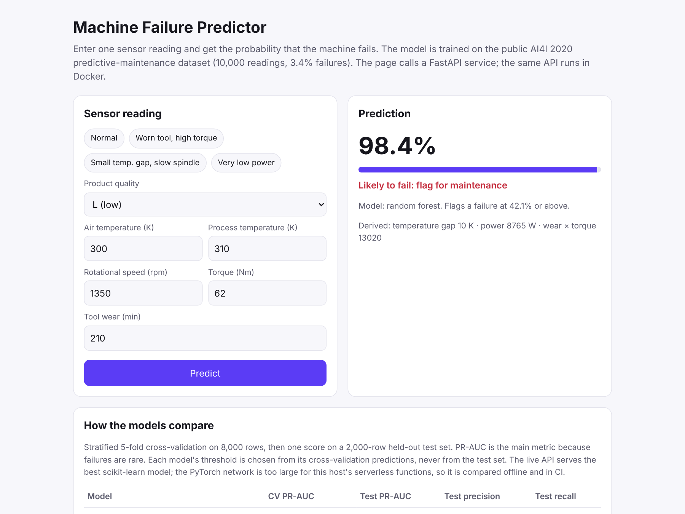
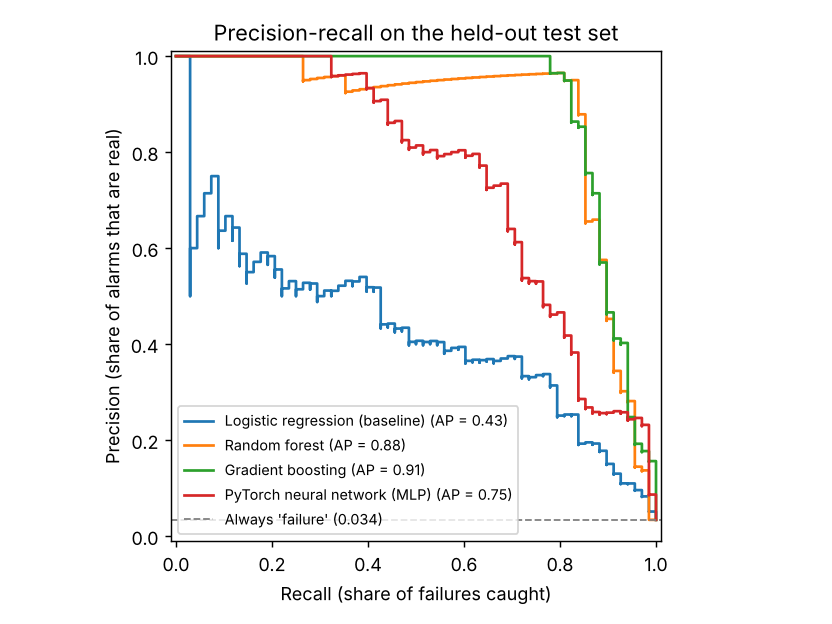
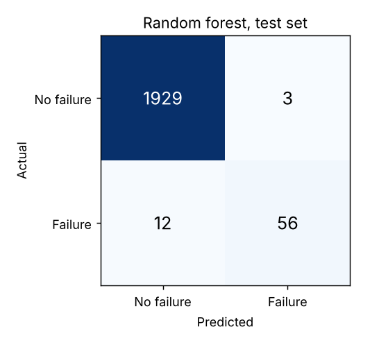
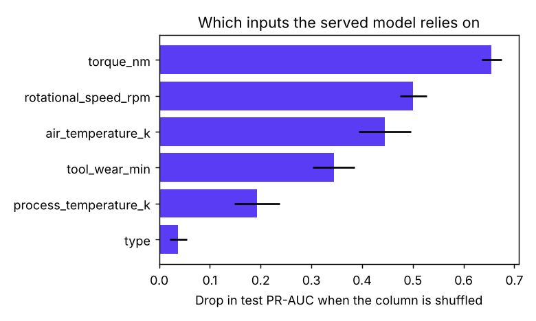

# Machine Failure Predictor

Predicts whether a machine is about to fail from its sensor readings. The pipeline compares scikit-learn models with a PyTorch neural network, and the best model is served as a FastAPI service with a Docker image and a live demo.

**Live demo:** https://machine-failure-predictor.vercel.app · **API docs:** https://machine-failure-predictor.vercel.app/docs



## What it does

- **Data prep with pandas.** Loads the AI4I 2020 dataset (10,000 readings, 339 failures = 3.4%) and checks its schema, product types and label quirks.
  - IDs are dropped, and so are the five failure-mode flags, because a flag is only known after the failure and would leak the answer.
- **Feature engineering.** The features follow the failure rules in the dataset's documentation:
  - temperature gap (process − air), for heat-dissipation failures;
  - mechanical power (torque × angular speed), for power failures;
  - tool wear × torque, for overstrain failures.
  - Everything is one scikit-learn transformer, so training and serving share a single code path.
- **Model comparison.** Logistic regression (baseline), random forest and gradient boosting in scikit-learn, plus a PyTorch feed-forward network (MLP).
  - The network is wrapped as a scikit-learn estimator, so it goes through exactly the same pipeline, cross-validation and metrics.
- **Honest evaluation:**
  - The test set is a stratified 20% hold-out that is touched once.
  - Models are compared with stratified 5-fold cross-validation on the rest.
  - **PR-AUC** is the main metric, because failures are rare.
  - Each model's decision threshold is picked from its cross-validation predictions (max F1), never from the test set.
- **Serving.** A FastAPI app with Pydantic validation (types, physical bounds, unknown fields rejected).
  - It warns when an input is outside the range seen in training.
  - Endpoints: `/predict`, `/health`, `/model-info`.
  - The code uses small classes (OOP) for each step: `AI4IDataset`, `FeatureBuilder`, `TorchMLPClassifier`, `ModelService`.
- **Docker and CI:**
  - The Dockerfile builds a slim serving image without pandas or torch.
  - GitHub Actions runs the tests, then retrains everything from scratch and fails if the scores drift from the committed `artifacts/metrics.json`.
  - It also builds the Docker image and calls `/predict` on the running container.

## Results

Hold-out test set: 2,000 rows, 68 failures. Cross-validation: 5 folds on the other 8,000 rows.

| Model | CV PR-AUC | Test PR-AUC | Test precision | Test recall | Test confusion matrix (TN / FP / FN / TP) |
|---|---|---|---|---|---|
| Logistic regression (baseline) | 0.459 ± 0.042 | 0.430 | 0.532 | 0.368 | 1910 / 22 / 43 / 25 |
| **Random forest (served)** | **0.894 ± 0.025** | **0.876** | **0.949** | **0.824** | **1929 / 3 / 12 / 56** |
| Gradient boosting | 0.883 ± 0.020 | 0.907 | 0.949 | 0.824 | 1929 / 3 / 12 / 56 |
| PyTorch neural network (MLP) | 0.762 ± 0.022 | 0.747 | 0.734 | 0.691 | 1915 / 17 / 21 / 47 |

- **The served model:** at its threshold, the random forest catches **56 of the 68** test failures with **3 false alarms**.
- **Why random forest is served:** it is chosen on cross-validated PR-AUC, which is decided before the test set is seen.
  - Gradient boosting scores higher on this particular test split (0.907 vs 0.876) but lower in cross-validation (0.883 vs 0.894).
  - With a fold-to-fold spread of about ± 0.02, the two are close. Switching after looking at the test set would be tuning on the test set.
- **The linear baseline is weak.** Failures happen when features cross thresholds (for example power below a limit), so they are not linearly separable.
- **Trees beat the neural network here.** On small tabular data with sharp, rule-like boundaries, tree ensembles usually do better. The MLP was tuned lightly on the cross-validation folds only: hidden layers (64, 32), Adam, 150 epochs and a class-weighted loss (`pos_weight` ≈ 28).
- **What the model relies on:** permutation importance on the test set shows torque, rotational speed, air temperature and tool wear matter most. This matches the dataset's documented failure rules.

| | |
|---|---|
|  |  |
|  | |

### Limits

- **The data is synthetic.** AI4I 2020 is generated to mimic a milling process, and its failure rules are known, so high scores here say little about real machines.
- **Mislabelled-looking rows are kept as labelled.** 9 failures have no failure mode flagged, and 18 random-failure (RNF) flags are labelled "no failure".
- **Random failures (RNF) are unpredictable by design.**
- **The live demo serves the scikit-learn model only.** PyTorch is too large for Vercel's serverless function size limit, so the MLP is trained, compared and tested in the pipeline and CI, not served.

## Architecture

```
data/ai4i2020.csv
   │  AI4IDataset (pandas: load, schema checks, drop IDs + leaky failure-mode flags)
   ▼
FeatureBuilder (one-hot type, temperature gap, power, wear × torque)
   ▼
Pipelines: logistic regression | random forest | gradient boosting | PyTorch MLP
   │  stratified 5-fold CV → threshold from out-of-fold predictions → one score on the hold-out set
   ▼
artifacts/model.joblib + metrics.json + public/figures/*.png
   ▼
FastAPI (app.py) ── /predict  /health  /model-info  /  (demo page)
   ├── Docker image (python:3.12-slim, non-root)
   └── Vercel (live demo)
```

## Stack

Python 3.12 · pandas · NumPy · scikit-learn · PyTorch · matplotlib · FastAPI · Pydantic · Docker · pytest · GitHub Actions · Vercel

## Run it locally

```bash
# serve the saved model
pip install -r requirements.txt
uvicorn app:app --reload            # http://127.0.0.1:8000 and /docs

# or with Docker
docker build -t machine-failure-predictor .
docker run -p 8000:8000 machine-failure-predictor

# call the API
curl -X POST http://127.0.0.1:8000/predict -H 'Content-Type: application/json' \
  -d '{"type":"L","air_temperature_k":300,"process_temperature_k":310,"rotational_speed_rpm":1350,"torque_nm":62,"tool_wear_min":210}'
```

## Retrain and test

```bash
pip install torch --index-url https://download.pytorch.org/whl/cpu   # CPU-only PyTorch
pip install -r requirements-dev.txt

python -m mfp.train                     # about a minute on CPU; rewrites artifacts/ and public/figures/
pytest                                  # 32 tests: data checks, features, metrics, PyTorch model, service, API, training
python scripts/check_reproducible.py    # retrain from scratch and compare with artifacts/metrics.json
```

## Project layout

```
mfp/data.py       dataset loading, schema checks, data report
mfp/features.py   FeatureBuilder (scikit-learn transformer)
mfp/models.py     the four candidate pipelines
mfp/nn.py         TorchMLPClassifier (PyTorch, scikit-learn compatible)
mfp/evaluate.py   PR-AUC, threshold choice, confusion matrix
mfp/train.py      cross-validation, comparison, saving artifacts and plots
mfp/service.py    ModelService used by the API
app.py            FastAPI app
public/           demo page and figures
tests/            pytest suite
```

## Data and licence

- **Dataset:** S. Matzka, *AI4I 2020 Predictive Maintenance Dataset*, UCI Machine Learning Repository, [CC BY 4.0](https://creativecommons.org/licenses/by/4.0/). Included unchanged; see [`data/README.md`](data/README.md).
- **Code:** MIT licence.
